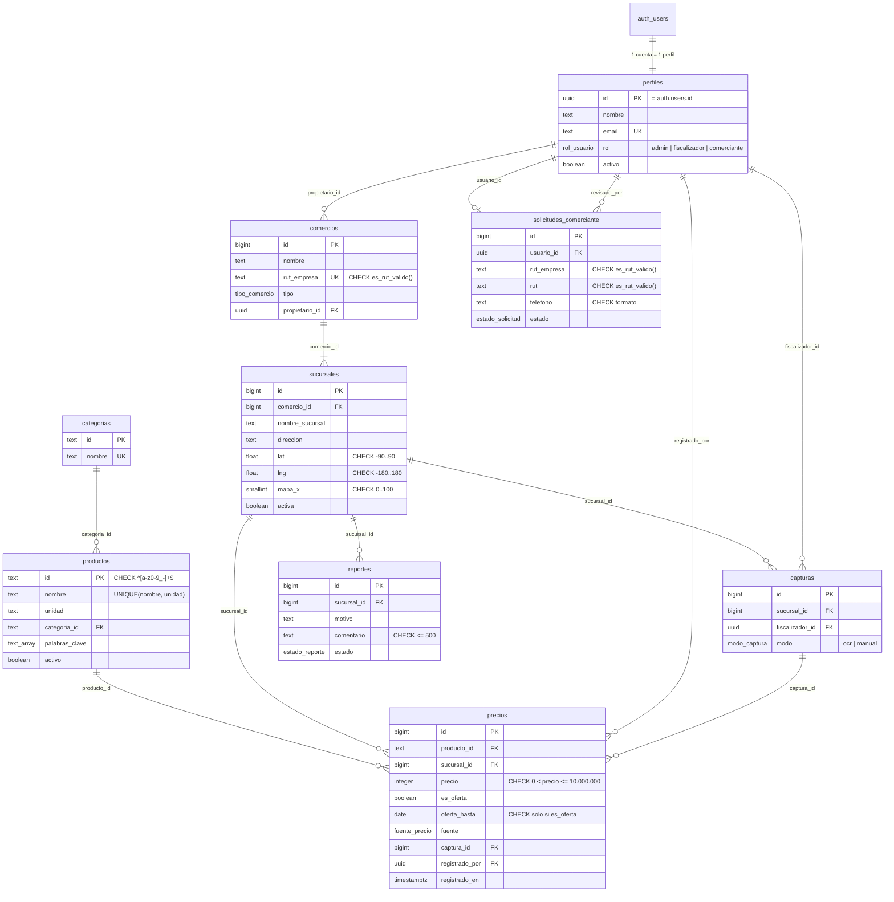

# Base de datos (Supabase · PostgreSQL)

- **Proyecto Supabase:** `observatorio-precios-pac` (ref `cygqzrdeofngskjwmrir`), región `sa-east-1` (São Paulo), plan gratuito.
- **URL de la API:** `https://cygqzrdeofngskjwmrir.supabase.co`
- **Migraciones (SQL que reproduce el esquema):** [`supabase/migrations/`](../supabase/migrations/)
- **Datos de prueba:** [`supabase/seed.sql`](../supabase/seed.sql)
- **Edge Functions:** [`supabase/functions/`](../supabase/functions/)

## Diagrama de relaciones



Tablas sin relaciones (las llenan triggers o la app): `auditoria` (quién cambió qué y cuándo) y `eventos_app` (monitoreo: duración de operaciones y errores).

## Tablas

| Tabla | Para qué sirve | Filas iniciales |
|---|---|---|
| `perfiles` | Rol y estado de cada cuenta del personal. Las credenciales viven en `auth.users` (Supabase Auth, contraseñas con bcrypt). | 9 |
| `categorias` | Categorías del catálogo municipal. | 5 |
| `productos` | Catálogo municipal: solo se registran precios de estos productos. | 14 |
| `comercios` | Empresa o comerciante; puede tener dueño (`propietario_id`). | 7 |
| `sucursales` | Puntos de venta, con ubicación y beneficio Tarjeta Vecina. | 8 |
| `precios` | **Historial inmutable** de observaciones de precio (no se actualiza, se agrega). | 258 |
| `capturas` | Visitas del fiscalizador (OCR o manual); sus precios apuntan a la captura. | 6 |
| `reportes` | Reportes ciudadanos de precios incorrectos (sin cuenta). | 0 |
| `solicitudes_comerciante` | Registro de comerciantes pendiente de aprobación. | 3 |
| `auditoria` | Log de auditoría escrito por triggers. | 7 |
| `eventos_app` | Registro de actividad de la app (monitoreo). | — |

**Vista `precios_vigentes`** (comparador ciudadano): el último precio de cada producto en cada sucursal (`DISTINCT ON (producto_id, sucursal_id) ... ORDER BY registrado_en DESC`), con `security_invoker = true` para que respete RLS.

## Restricciones e integridad

- **Claves foráneas** en todas las relaciones, con `ON DELETE RESTRICT` donde borrar dejaría precios huérfanos (productos, sucursales) y `SET NULL` donde se puede conservar el registro (autor de un precio).
- **CHECK**: precio entre 1 y 10.000.000; `oferta_hasta` solo si `es_oferta`; coordenadas válidas; teléfono con formato chileno; largo de textos; id de producto en minúsculas sin espacios.
- **RUT validado en la base de datos** con `public.es_rut_valido()` (módulo 11), la misma regla que `src/lib/rut.ts`.
- **UNIQUE**: email de perfil, RUT de empresa, (nombre, unidad) de producto, una solicitud por cuenta.
- **Triggers**:
  - `precios_antes_de_insertar`: fija `registrado_por = auth.uid()` y `registrado_en = now()` (el cliente no puede falsificar autor ni fecha) y rechaza productos o sucursales desactivados.
  - `auditoria_*`: registran cada INSERT/UPDATE/DELETE en `auditoria`.
  - `sucursales_proteger` / `perfiles_proteger`: un comerciante no puede mover su sucursal a otro comercio; nadie salvo el admin cambia rol, email o estado.
- **Transacciones**: `registrar_captura()` guarda la captura y todos sus precios o nada; `aprobar_solicitud()` activa la cuenta y crea el comercio en un solo paso.

## Extensiones

| Extensión | Uso |
|---|---|
| `pg_trgm` | Búsqueda aproximada de productos (`buscar_productos('arros')` → Arroz) con índice GIN. |
| `unaccent` | Búsqueda sin tildes ("azucar" → "Azúcar"). |
| `pgcrypto` | Hash bcrypt de las contraseñas de las cuentas de prueba en `seed.sql`. |

## Seguridad (Row Level Security)

RLS está activado en las 11 tablas. Las funciones auxiliares viven en el esquema `privado` (no expuesto por la API):
`privado.rol_actual()`, `privado.es_admin()`, `privado.es_personal_municipal()`, `privado.es_duenio_sucursal(id)`, `privado.es_duenio_comercio(id)`.
Solo cuentan los perfiles **activos**: una cuenta desactivada o pendiente no tiene permisos aunque inicie sesión.

| Tabla | Ciudadano (anon) | Comerciante | Fiscalizador | Administrador |
|---|---|---|---|---|
| productos, categorías | leer activos | leer | leer | todo |
| comercios, sucursales | leer activas | editar **solo las suyas** | leer todas | todo |
| precios | leer | insertar **solo en sus sucursales** (fuente comerciante/carga) | insertar en cualquiera (fuente fiscalizador/ocr) | insertar, borrar |
| capturas | — | — | crear y ver las suyas | ver todas |
| reportes | crear | crear | ver | ver, gestionar |
| solicitudes | — (se crean por Edge Function) | ver la propia | — | ver, aprobar/rechazar (RPC) |
| perfiles | — | ver el propio | ver el propio | ver y editar todos |
| auditoria, eventos_app | insertar eventos | insertar eventos | insertar eventos | leer |

## Cambios respecto del diseño de la EV2

El README de la versión anterior proponía las tablas `productos`, `comercios`, `precios`, `usuarios` y `auditoria`. Al implementarlo:

1. `comercios` se separó en **`comercios`** (empresa, RUT, dueño) y **`sucursales`** (punto de venta): un comerciante tiene varias sucursales (Minimarket El Sol tiene 2) y los permisos se controlan por sucursal.
2. `usuarios` pasó a ser **`perfiles`**, enlazada 1:1 con `auth.users`: Supabase Auth guarda las credenciales y `perfiles` solo el rol y el estado.
3. Se agregaron **`categorias`** (antes era texto libre), **`capturas`** (agrupa los precios de una visita del fiscalizador), **`reportes`**, **`solicitudes_comerciante`** y **`eventos_app`**.
4. `precios` pasó a ser un **historial inmutable** (sin UPDATE) y el precio actual se obtiene con la vista `precios_vigentes`.

## Cómo reproducir la base de datos

**Opción A · Supabase CLI**

```bash
npx supabase login
npx supabase link --project-ref <ref-del-proyecto>
npx supabase db push                 # aplica supabase/migrations en orden
npx supabase db execute -f supabase/seed.sql   # o pegar seed.sql en el SQL Editor
npx supabase functions deploy registro-comerciante --no-verify-jwt
npx supabase functions deploy admin-usuarios
```

**Opción B · SQL Editor del panel de Supabase**: ejecutar los archivos de `supabase/migrations/` en orden (100 → 700) y después `supabase/seed.sql`.
